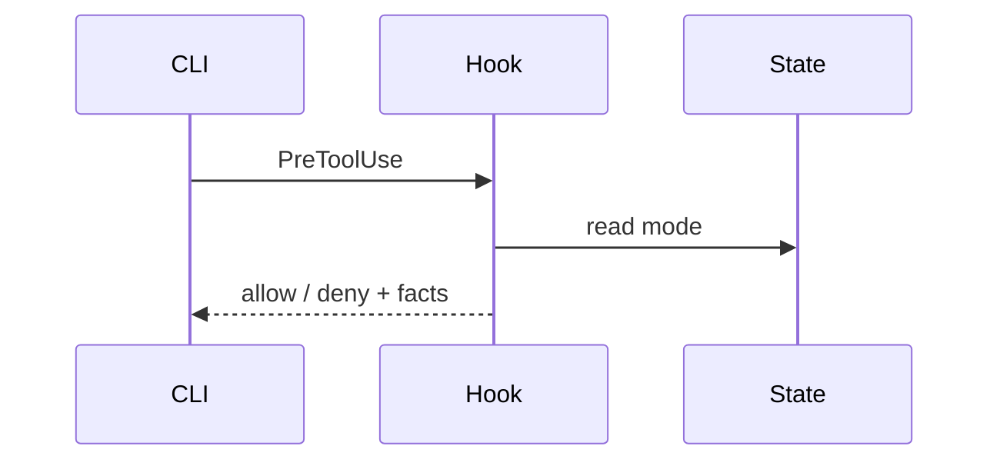

# Diagram

## Purpose

**다이어그램은 장식이 아니라 하중(load-bearing)이다.** 독자가 문장들로부터 전체 형태를 머릿속에 재구성해야 할 때만 쓰고, 그 질문에 답하는 가장 작은 뷰를 고른다. 대화 안에서는 텍스트 블록 또는 Mermaid로 렌더한다. 아티팩트 파일은 최대 하나만 작성한다.

## Workflow

1. 뷰를 하나(최대 둘) 고른다. 셋 이상은 노이즈다.
2. 현재 질문에 답하는 호출·파일·props·상태·경계만 싣는다. 여분 노드는 독자의 해독 비용이다.
3. 한 문장으로 답이 되면 다이어그램 없이 문장을 쓴다.
4. 각 시각은 그 시각을 뒷받침하는 2~3문장 바로 옆에 배치한다.

## Output Contract (어휘)

- **의사코드** — 언어 노이즈 없는 로직의 분기 형태
- **호출 트리** — 런타임 제어 흐름. 깊이 = 흐름 소유권, 관심 엣지에 주석
- **컴포넌트 트리** — UI·모듈 구조, 중요한 경계를 인라인 주석
- **파일 트리** — 책임의 위치. 얕게, 디렉터리당 주석 하나
- **Mermaid** — 당사자 간 상호작용·데이터플로·상태 전이
- **Diff** — 이미 존재하는 구조 대비 변경의 형태 (컴포넌트/파일 레이아웃/제어 흐름/상태머신 중 주제에 맞게)
- **전체 블록** — 소유권·실행 순서를 숨기면 안 될 때 한 번만, 복사 가능하게

예시:

```text
on(request)
  if state file locked by another writer
    queue and return pending
  acquire lock
  write
  release
```



## Operating Rules

- 텍스트로도 벅찬 경우(UI 레이아웃, before/after 비교, Mermaid로도 밀도가 높은 개념)에만 집중된 HTML 파일 하나를 작성한다. 제품의 색·서체·컴포넌트 스타일을 따르고, 실제 라벨·데이터를 채우며, 데스크톱·모바일 모두 동작하게. 플랫폼 오프너로 열고(`xdg-open` on Linux) 끝낸다. 하나지 갤러리가 아니다.
- 다이어그램을 대화에 텍스트로 보여줄 수 없으면 `~/workspace/`에 하나만 쓰고 링크한다.
