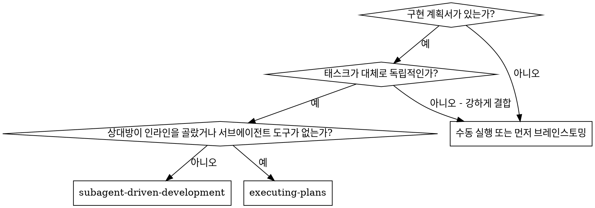

# 서브에이전트 주도 개발

태스크마다 새 구현자 서브에이전트를 파견하고, 각 태스크 뒤에 태스크 리뷰(스펙
준수 + 코드 품질)를 하고, 마지막에 넓은 전체 브랜치 리뷰를 한다.

**서브에이전트를 쓰는 이유:** 격리된 컨텍스트의 전문 에이전트에게 위임한다. 지시와
컨텍스트를 정밀하게 만들어 집중하고 성공하게 한다. 내 세션의 컨텍스트·히스토리를
물려주지 않는다 — 필요한 것만 구성한다. 내 컨텍스트는 조정 작업용으로 보존한다.

**핵심 원칙:** 태스크마다 새 서브에이전트 + 태스크 리뷰(스펙 + 품질) + 넓은 최종 리뷰 = 높은 품질, 빠른 반복

**서술:** 도구 호출 사이에는 한 줄 이내로만 말한다.

**연속 실행:** 태스크 사이에 상대방에게 확인하지 않는다. 아래 네 가지이거나
모든 태스크 완료일 때만 멈춘다.

**판결, 정지 아님.** 충돌·모호함·계획 결함 — 판단한다. 스펙이 구속력 있는 권위고,
계획은 그 논증이다. 모든 결정은 장부에 `Ruling: <결정 내용> — <이유> — <틀렸을 때 비용>`으로
기록하고 계속 간다.

네 가지만이 멈춘다: 되돌릴 수 없거나 파괴적인 작업, 보안 민감 작업, 관례상 먼저
물어보는 워크트리 밖 부작용(머지·공유 브랜치 푸시·배포), 모든 전진 경로가 추측뿐인
깨진 계획.

**[환경 한계]** 이 서브에이전트 환경에서는 직접 서브에이전트를 파견할 수 없다.
서브에이전트 파견이 필요한 단계에서는 상위 에이전트에게 파견을 요청한다 —
디스패치 프롬프트(이 스킬의 템플릿)를 그대로 보고서에 담아 전달하고, 결과가
돌아오면 절차를 이어간다.

## 사용 시점

## 절차

태스크 루프: 구현자 파견 → 보고서 처리 → 태스크 리뷰 → (실패 시) 수정 루프(최대 5라운드) → 완료. 전부 끝나면 최종 리뷰 → 수정 웨이브 1회 → 잔여 판정 → 워크스페이스 삭제 → finishing-a-development-branch.

## 준비

using-git-worktrees 스킬로 격리된 워크스페이스를 확보하거나 기존 것을 확인한다.
상대방의 명시적 동의 없이 main/master에서 구현을 시작하지 않는다.

- 각 계획은 워크스페이스를 소유한다: 시작 시 이 스킬의 `bash scripts/sdd-workspace PLAN_FILE` — 계획의 git-ignored 디렉토리(`<repo-root>/.superpowers/sdd/<plan-basename>/`) 경로 출력. 다른 계획의 디렉토리는 읽지도 쓰지도 않는다.
- `<workspace>/progress.md` 장부 확인. 첫 줄이 내 계획서 파일을 가리키면 `Task <N>: complete` 줄이 있는 태스크는 끝 — 다시 파견하지 않는다. 수정 루프 중인 태스크(마지막 줄이 fix round)는 다음 라운드부터 재개한다.
- 장부 첫 줄: `# SDD ledger — plan: <plan file path>`.
- 계획서를 한 번 읽고, 스펙도 읽고, 태스크마다 todo를 만든다.

Task 1 파견 전, 계획서를 충돌 스캔한다: 파일·인터페이스를 공유하는 태스크 쌍마다
한 행(두 태스크, 한쪽이 만드는 것과 다른 쪽이 쓰는 것, 발견 내용). 태스크마다
자체 일관성 한 행(지목한 테스트 대 지목한 코드). 스캔 결과를 장부에 쓰고,
발견한 것은 실행 전에 판결한다.

## 모델 선택

각 역할에 감당 가능한 가장 약한 모델을 쓴다.

- **기계적 구현** (격리된 함수, 명확한 스펙, 1-2 파일): 빠르고 저렴한 모델
- **통합·판단** (다중 파일 조정, 패턴 매칭, 디버깅): 표준 모델
- **아키텍처·설계**: 가장 유능한 가용 모델 — 최종 전체 브랜치 리뷰가 여기
- **리뷰**: diff 크기·복잡도·리스크에 맞춘 판단력. 작은 기계적 diff에 최상급 불필요.
- **수정 루프 4-5라운드**: 막힌 구현자보다 한 티어 위

**파견 시 모델을 항상 명시한다.** 생략하면 세션 모델을 물려받는다 — 대개 가장
유능하고 비싸며, 이 섹션을 무력화한다.

## 태스크 루프

**같은 모양의 작은 작업은 묶는다.** 같은 종류의 작고 독립적인 편집(같은 한 줄
수정·상수 변경·필드 추가)이 여러 태스크에 반복되면 태스크당 파견하지 않는다.
파일과 변경을 나열한 디스패치 브리프 하나를 만들어 서브에이전트 하나에게 보내고
diff를 하나로 리뷰한다.

### 1. 구현자 파견

파견 전 BASE(`git rev-parse HEAD`)를 기록한다 — 리뷰 패키지와 수정 라운드 diff가 쓴다.

- **태스크 브리프:** 파견 전 이 스킬의 `bash scripts/task-brief PLAN_FILE N` — 태스크 전체 텍스트를 고유 이름 파일로 추출해 경로를 출력한다. 브리프가 요구사항의 단일 출처로 남는다. 디스패치 프롬프트 구성: (1) 이 태스크가 프로젝트에서 어디인지 한 줄, (2) 브리프 경로 — "먼저 읽어라. 정확한 값을 그대로 쓸 요구사항이다", (3) 브리프가 알 수 없는 이전 태스크의 인터페이스·결정, (4) 내가 발견한 모호함의 해소, (5) 보고서 파일 경로와 보고서 계약. 정확한 값(숫자·문자열·시그니처·테스트 케이스)은 브리프에만 있다. 서브에이전트에게 전체 계획서를 읽히지 않는다.
- **보고서 파일:** 브리프 뒤에 이름을 붙인다 (브리프 `…/task-N-brief.md` → 보고서 `…/task-N-report.md`).
- 디스패치 프롬프트는 한 태스크를 설명한다, 세션 히스토리를 아니다. 누적 요약을 붙이지 않는다 — 새 서브에이전트에게 필요한 것은 태스크, 닿는 인터페이스, 전역 제약뿐이다.
- 디스패치에는 no-subagents 계약을 싣는다 (구현자 템플릿에 있음): 구현자는 서브에이전트를 파견하지 않는다 — 헬퍼도, 리뷰어도. 리뷰는 보고서 뒤에 내가 파견한다.
- **구현 서브에이전트를 병렬로 파견하지 않는다** (충돌).

템플릿: [implementer-prompt.md](implementer-prompt.md)

**파견된 서브에이전트를 기다릴 때:** 짧은 타임아웃으로 기다림을 폴링하지 말고,
조용히 열린 대기에도 앉아 있지 않는다. 장부 업데이트·다음 리뷰 패키징·보고서
읽기 같은 로컬 작업이 있으면 계속 일한다 — 자식 결과는 알아서 온다. 정말
대기뿐이면, 플랫폼이 허용하는 범위에서 제한된 구간(5~10분)으로 기다리고,
구간 사이에 한 줄 상태와 자식 목록을 점검한다.

### 2. 보고서 처리

**DONE:** 리뷰 패키지 생성 (`bash scripts/review-package PLAN_FILE BASE HEAD` — 파견 전 기록한 BASE를 쓴다, `HEAD~1` 금지) 후 태스크 리뷰어를 파견한다.

**DONE_WITH_CONCERNS:** 우려를 먼저 읽는다. 정확성·범위 문제면 리뷰 전에 해소한다. 관찰이면 기록하고 리뷰로 간다.

**NEEDS_CONTEXT:** 빠진 맥락을 주고 다시 파견한다.

**BLOCKED:** 차단 원인 평가: (1) 맥락 문제면 맥락 보충 후 같은 모델로, (2) 추론 부족이면 더 유능한 모델로, (3) 너무 크면 쪼개고, (4) 계획 자체가 틀렸으면 판결하고 장부에 기록한 뒤 판결을 싣고 파견한다. **에스컬레이션을 무시하거나, 같은 모델에 변화 없이 재시도하지 않는다.**

구현자가 질문하면 명확히 완전히 답하고 맥락을 보충한다. 서두르지 않는다.

### 3. 태스크 리뷰

태스크 리뷰는 태스크 범위 게이트다. 넓은 리뷰는 마지막에 한 번. 태스크 리뷰를
건너뛰지 말고, 스펙 준수·태스크 품질 두 판정 없는 보고서를 받지 않는다.

- 리뷰어에게 diff를 파일로 준다: `bash scripts/review-package PLAN_FILE BASE HEAD`를 실행하고 출력된 경로를 넘긴다. 파견 전 기록한 BASE를 쓴다 — `HEAD~1` 금지.
- **리뷰어 입력:** 브리프 파일, 보고서 파일, 리뷰 패키지의 세 경로 + 태스크를 묶는 전역 제약.
- 전역 제약 블록이 리뷰어의 주의 렌즈다. 계획서의 Global Constraints 섹션이나 스펙에서 구속 요구사항을 그대로 복사한다: 정확한 값·형식, 컴포넌트 간 관계.
- 이유 없는 열린 지시("모든 사용처 확인", "유용하면 레이스 테스트")를 붙이지 않는다.
- 구현자가 같은 코드에 이미 실행한 테스트를 리뷰어에게 다시 실행시키지 않는다.
- **리뷰어를 미리 판단하지 않는다** — "무시하라", "결함으로 보지 마라", "최대 Minor", "계획이 정했다" 같은 지시가 프롬프트에 들어가면 멈춰라: 리뷰 루프를 아끼려는 미리 판단이다.
- 리뷰어가 "⚠️ diff로 검증 불가" 항목을 보고하면, 태스크 완료 전에 내가 직접 해소한다. 확인된 실제 빠짐은 실패한 스펙 리뷰로 취급 — 수정 루프 진입.

템플릿: [task-reviewer-prompt.md](task-reviewer-prompt.md)

### 4. 수정 루프

리뷰가 스펙 ❌, Critical·Important 발견, 또는 내가 실제 빠짐으로 확인한 ⚠️ 항목을
보고하면 루프가 시작된다.

- Minor 발견은 장부에 기록 (`Task <N>: minor (deferred): <한 줄>`). 최종 전체 브랜치 리뷰가 머지 전 triage 하도록 그 목록을 가리킨다.
- 계획이 강제하는 발견(계획 텍스트와 충돌)은 내가 판결한다: 스펙을 구속 권위로 발견과 계획 텍스트를 저울질하고, 행동 전에 장부에 판결을 기록한다.
- 나머지는 루프 진입. 수정 라운드는 수정 파견 1회 + 범위 제한 재리뷰 1회. 태스크당 최대 5라운드.

**1-3라운드 — 원래 구현자 재개.** 발견을 그대로 전달한다. 컨텍스트가 살아 있다. 살아 있는 서브에이전트에게 메시지를 못 보내는 하네스라면 브리프 경로·보고서 파일 경로·발견을 싣고 새 구현자를 파견한다.

**4-5라운드 — 더 유능한 모델로 새 구현자** (모델 선택 참조). 브리프 경로·보고서 파일 경로·열린 발견 + "이전 구현자가 N번 시도했고 지금 당신이 소유한다. 시도한 내용은 보고서 파일을 읽어라."

**매 라운드:** 구현자는 수정하고, 고친 코드를 다루는 테스트를 다시 실행하고, 같은 보고서 파일에 수정 보고서를 추가하고, 짧은 계약으로 복귀한다. 재리뷰 파견 전, 수정 보고서에 다루는 테스트·실행 명령·출력이 있는지 확인한다.

**재리뷰는 범위가 제한된다.** `bash scripts/review-package PLAN_FILE FIX_BASE HEAD` (FIX_BASE = 이전 리뷰가 본 head) 실행 후 [re-review-prompt.md](re-review-prompt.md) 파견 — 발견 목록, 브리프, 보고서 파일, diff 경로. 재리뷰어는 각 발견을 ADDRESSED/NOT ADDRESSED로 판정하고, 수정 diff의 새 파손만 지적한다. 새 Critical/Important 파손은 열린 발견 목록에 합류한다.

**매 라운드 뒤 장부 추가:** `Task <N>: fix round <R>/5 (<X> addressed, <Y> open — <발견 한 줄>; commits <a7>..<b7>)`

컨트롤러 세션에서 내가 직접 수정하지 않는다 — 내 컨텍스트는 조정용으로 깨끗하게 유지하고, 컨트롤러 수정은 리뷰를 건너뛴다.

**차단기.** 5라운드 재리뷰 뒤에도 열린 발견이 남으면 파견을 멈추고 내가 각 열린 발견을 판정한다:

- **리뷰어가 틀렸거나 논쟁 가능:** 보류 — `Task <N>: parked — <발견> — Ruling: <코드가 유지되는 이유>`. 최종 리뷰가 양쪽을 본다.
- **실제지만 하류가 그 위에 쌓이지 않음:** 같은 방식으로 보류, 실제이고 연기됐다는 판결.
- **실제이고 하중을 받음** (이후 태스크가 그 위에 쌓이거나 계획 결함을 드러냄): 종속 작업을 푸는 최소 변경을 판결하고 장부에 기록한 뒤 다음 태스크 파견에 싣는다.

판정은 상한에서만 한다. 일찍 판정해서 루프를 끝내는 것은 다른 이름의 미리 판단이다. 모든 판정은 장부 항목 — 조용한 폐기는 금지.

### 5. 태스크 완료

리뷰가 깨끗하거나, 모든 열린 발견이 상한에서 판결과 함께 보류되면, 같은 메시지의 다른 장부와 함께 완료 줄을 장부에 추가한다:

- `Task <N>: complete (commits <base7>..<head7>, review clean)`
- `Task <N>: complete (commits <base7>..<head7>, <K> parked)` (차단기 작동 후)

todo를 완료 표시하고 다음으로. 리뷰에 열린 Critical/Important가 고쳐지지도 상한에서 판결과 함께 보류되지도 않은 채로 다음 태스크로 가지 않는다.

## 최종 리뷰

`bash scripts/review-package PLAN_FILE MERGE_BASE HEAD` (MERGE_BASE = 브랜치가 시작된 커밋, 예: `git merge-base main HEAD`) 실행하고 출력된 경로를 최종 리뷰 파견에 포함한다. 가장 유능한 가용 모델로 파견하고, requesting-code-review 스킬의 [code-reviewer.md](../requesting-code-review/code-reviewer.md)를 사용한다. 장부의 deferred-minor·parked 줄을 가리켜 머지 전 triage 하게 한다.

최종 전체 브랜치 리뷰가 발견을 돌려주면 **발견당 수정자가 아닌** 수정 서브에이전트 하나에게 전체 발견 목록을 파견한다. 그 다음 수정 범위에 대해 정확히 한 번의 범위 제한 재리뷰 (`bash scripts/review-package PLAN_FILE FIX_BASE HEAD`, [re-review-prompt.md](re-review-prompt.md)). 잔여 발견은 태스크 루프의 차단기처럼 판정한다. 두 번째 수정 웨이브는 없다.

## 마무리

삭제 전에 장부의 `Ruling:` 포함 줄을 전부 최종 메시지의 "내가 내린 판결" 아래에 순서대로 모은다 — 각각 틀렸을 때 비용과 함께. 빠짐없이. 그 목록이 내가 상대방 대신 내린 결정이 그들에게 닿는 유일한 곳이다.

최종 전체 브랜치 리뷰가 깨끗하고 수정이 머지되면 이 계획의 워크스페이스를 삭제한다 (`rm -rf <workspace>`) — 기록은 이제 git에 있다. 형제 디렉토리는 다른 계획의 것 — 손대지 않는다.

finishing-a-development-branch 스킬을 사용한다.

## 흔한 합리화

| 변명 | 현실 |
|------|------|
| "스펙 준수는 대충 맞췄다" | 리뷰어가 스펙 빠짐을 찾았으면 미완이다. 고치거나 상한까지 가서 판정 — 출구는 둘뿐이다. |
| "내가 직접 고치자, 파견은 오버헤드다" | 컨트롤러 수정은 내 컨텍스트를 오염시키고 리뷰를 건너뛴다. 구현자를 재개한다. |
| "한 라운드 더면 수렴한다" | 상한을 넘기면 라운드는 수렴하지 않는다 — 실패는 구조적이다. 판정하고 라우팅한다. |
| "리뷰어가 또 뭐든 찾을 거다" | 범위 제한 재리뷰는 수정을 검증한다. 헤매지 않는다. |
| "이 발견은 명백히 틀렸으니 버린다" | 판정은 상한에서만, 모든 판결은 장부 항목이다. 조용한 폐기는 금지. |
| "수정이 작으니 재리뷰는 건너뛴다" | 리뷰 없는 수정이 회귀를 만든다. 모든 라운드는 범위 제한 재리뷰로 끝난다. |
| "장부 기록은 오버헤드다" | 장부는 압축을 견디는 것이다. 장부 없는 컨트롤러는 완료된 태스크 시퀀스 전체를 다시 파견했다. |
| "구현자가 자기 리뷰어를 띄웠네 — 공짜 확보다" | 같은 diff를 보는 중복 좌석이다. 태스크 리뷰가 게이트다. 작업자가 띄운 리뷰어는 결함으로 지적할 대상이지 엄격함이 아니다. |
