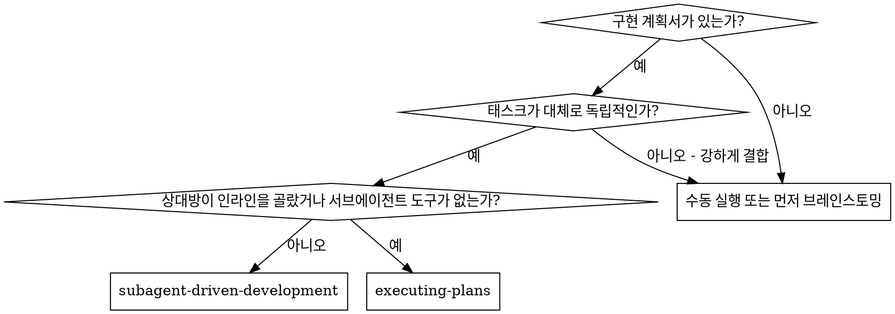

# 서브에이전트 주도 개발

태스크마다 새 구현자 서브에이전트를 파견하고, 각 태스크 뒤에 태스크 리뷰(스펙
준수 + 코드 품질)를 하고, 마지막에 넓은 전체 브랜치 리뷰를 한다.

**서브에이전트를 쓰는 이유:** 격리된 컨텍스트의 전문 에이전트에게 위임한다. 지시와
컨텍스트를 정밀하게 만들어 집중하고 성공하게 한다. 내 세션의 컨텍스트·히스토리를
물려주지 않는다 — 필요한 것만 구성한다. 내 컨텍스트는 조정 작업용으로 보존한다.

**핵심 원칙:** 태스크마다 새 서브에이전트 + 태스크 리뷰(스펙 + 품질) + 넓은 최종 리뷰 = 높은 품질, 빠른 반복

**서술:** 도구 호출 사이에는 한 줄 이내로만 말한다.

**연속 실행:** 태스크 사이에 상대방에게 확인하지 않는다. 아래 네 가지이거나
모든 태스크 완료일 때만 멈춘다.

**판결, 정지 아님.** 충돌·모호함·계획 결함 — 판단한다. 스펙이 구속력 있는 권위고,
계획은 그 논증이다. 모든 결정은 장부에 `Ruling: <결정 내용> — <이유> — <틀렸을 때 비용>`으로
기록하고 계속 간다.

네 가지만이 멈춘다: 되돌릴 수 없거나 파괴적인 작업, 보안 민감 작업, 관례상 먼저
물어보는 워크트리 밖 부작용(머지·공유 브랜치 푸시·배포), 모든 전진 경로가 추측뿐인
깨진 계획.

**[환경 한계]** 이 서브에이전트 환경에서는 직접 서브에이전트를 파견할 수 없다.
서브에이전트 파견이 필요한 단계에서는 상위 에이전트에게 파견을 요청한다 —
디스패치 프롬프트(이 스킬의 템플릿)를 그대로 보고서에 담아 전달하고, 결과가
돌아오면 절차를 이어간다.

## 사용 시점

**인라인 실행(executing-plans)과 비교:**
- 태스크마다 새 서브에이전트(컨텍스트 오염 없음) — 한 컨텍스트가 모든 태스크를 하는 대신
- 태스크마다 리뷰(스펙 준수 + 코드 품질) — 마지막에만 하는 대신
- 태스크·리뷰마다 새 컨텍스트 비용 — 인라인은 한 컨텍스트 + 최종 리뷰어 한 명
- 둘 다 이 세션에서 돌아가고, 같은 계획 워크스페이스·장부를 공유하고, 태스크 사이에 멈추지 않는다

## 절차

태스크 루프: 구현자 파견 → 보고서 처리 → 태스크 리뷰 → (실패 시) 수정 루프(매 라운드 전 references/fix-loop.md 필독, 최대 5라운드) → 완료. 전부 끝나면 최종 리뷰(references/final-review.md) → 워크스페이스 삭제 → finishing-a-development-branch.

## 준비

using-git-worktrees 스킬로 격리된 워크스페이스를 확보하거나 기존 것을 확인한다.
상대방의 명시적 동의 없이 main/master에서 구현을 시작하지 않는다.

대화 기억은 압축을 견디지 못한다. 실제 세션에서 자리를 잃은 컨트롤러가 완료된
태스크 시퀀스 전체를 다시 파견했다 — 관찰된 가장 비싼 실패다. 진행 상황은
todo만이 아니라 장부 파일로 추적한다.

- 각 계획은 워크스페이스를 소유한다: 시작 시 이 스킬의 `bash scripts/sdd-workspace PLAN_FILE` — 계획의 git-ignored 디렉토리(`<repo-root>/.superpowers/sdd/<plan-basename>/`) 경로 출력. 다른 계획의 디렉토리는 읽지도 쓰지도 않는다.
- `<workspace>/progress.md` 장부 확인. 장부가 있으면 [references/resuming.md](references/resuming.md)를 다른 무엇보다 먼저 읽는다: 누구의 장부인지, 어디서 재개하는지 알려준다.
- 장부 첫 줄: `# SDD ledger — plan: <plan file path>`.
- 장부는 복구 지도다: 장부가 가리키는 커밋은 git에 있다 — 컨텍스트가 만든 기억이 사라져도. 압축 뒤에는 내 기억보다 장부와 `git log`를 믿는다.
- `git clean -fdx`는 워크스페이스를 파괴한다 (git-ignored 스크래치). 그런 일이 생기면 `git log`에서 복구한다.
- 계획서를 한 번 읽고, 스펙도 읽고, 태스크마다 todo를 만든다.

Task 1 파견 전, [references/preflight.md](references/preflight.md)를 읽고 그
충돌 스캔을 실행한다. 그 표와 판결이 장부에 들어간다.

## 모델 선택

각 역할에 감당 가능한 가장 약한 모델을 쓴다.

- **기계적 구현** (격리된 함수, 명확한 스펙, 1-2 파일): 빠르고 저렴한 모델
- **통합·판단** (다중 파일 조정, 패턴 매칭, 디버깅): 표준 모델
- **아키텍처·설계**: 가장 유능한 가용 모델 — 최종 전체 브랜치 리뷰가 여기, 세션 기본이 아니라 가장 유능한 가용 모델로 파견한다
- **리뷰**: diff 크기·복잡도·리스크에 맞춘 판단력. 작은 기계적 diff에 최상급 불필요. 작은 수정 diff의 범위 제한 재리뷰는 저렴~중간 티어로.
- **수정 루프 4-5라운드**: 막힌 구현자보다 한 티어 위

**파견 시 모델을 항상 명시한다.** 생략하면 세션 모델을 물려받는다 — 대개 가장
유능하고 비싸며, 이 섹션을 무력화한다.

**턴 수가 토큰 단가보다 중요하다.** 벽시계 시간과 컨텍스트 비용은 서브에이전트가
몇 턴을 도는지에 비례하고, 가장 싼 모델은 다단계 작업에서 일상적으로 2~3배
턴을 돈다 — 전체로는 더 비싸다. 리뷰어와 산문 설명 기반 구현자의 하한은 중간
티어로. 계획 텍스트에 쓸 코드가 전부 들어 있으면 구현은 전사 + 테스트다: 그
구현자는 가장 싼 티어로. 한 파일 기계적 수정도 가장 싼 티어로.

**태스크 복잡도 신호 (구현 태스크):**
- 1-2파일 + 완전한 스펙 → 싼 모델
- 다중 파일 + 통합 우려 → 표준 모델
- 설계 판단·넓은 코드베이스 이해 → 가장 유능한 모델

## 태스크 루프

**같은 모양의 작은 작업:** 계획에 같은 종류의 작은 편집이 여러 파일에 걸쳐
나열되면, 파견 전에 [references/batching.md](references/batching.md)를 읽는다.

### 1. 구현자 파견

파견 전 BASE(`git rev-parse HEAD`)를 기록한다 — 리뷰 패키지와 수정 라운드 diff가 쓴다.

- **태스크 브리프:** 파견 전 이 스킬의 `bash scripts/task-brief PLAN_FILE N` — 태스크 전체 텍스트를 고유 이름 파일로 추출해 경로를 출력한다. 브리프가 요구사항의 단일 출처로 남는다. 디스패치 프롬프트 구성: (1) 이 태스크가 프로젝트에서 어디인지 한 줄, (2) 브리프 경로 — "먼저 읽어라. 정확한 값을 그대로 쓸 요구사항이다", (3) 브리프가 알 수 없는 이전 태스크의 인터페이스·결정, (4) 내가 발견한 모호함의 해소, (5) 보고서 파일 경로와 보고서 계약. 정확한 값(숫자·문자열·시그니처·테스트 케이스)은 브리프에만 있다. 서브에이전트에게 전체 계획서를 읽히지 않는다.
- **보고서 파일:** 브리프 뒤에 이름을 붙인다 (브리프 `…/task-N-brief.md` → 보고서 `…/task-N-report.md`). 구현자는 전체 보고서를 그곳에 쓰고, 상태·커밋·한 줄 테스트 요약·우려만 반환한다.
- 디스패치 프롬프트는 한 태스크를 설명한다, 세션 히스토리를 아니다. 누적 요약을 붙이지 않는다 — 새 서브에이전트에게 필요한 것은 태스크, 닿는 인터페이스, 전역 제약뿐이다.
- 디스패치에는 no-subagents 계약을 싣는다 (구현자 템플릿에 있음): 구현자는 서브에이전트를 파견하지 않는다 — 헬퍼도, 리뷰어도. 리뷰는 보고서 뒤에 내가 파견한다.
- 이전 태스크가 보류한 발견이 이 태스크 영역에 닿으면, 그 장부 항목 포인터를 디스패치에 싣는다.
- 파견 결과에서 구현자 에이전트 정체성을 기록한다 — 수정 루프 1-3라운드는 이 에이전트를 재개한다.
- **구현 서브에이전트를 병렬로 파견하지 않는다** (충돌).

템플릿: [implementer-prompt.md](implementer-prompt.md)

**파견된 서브에이전트를 기다릴 때:** 짧은 타임아웃으로 기다림을 폴링하지 말고,
조용히 열린 대기에도 앉아 있지 않는다. 장부 업데이트·다음 리뷰 패키징·보고서
읽기 같은 로컬 작업이 있으면 계속 일한다 — 자식 결과는 알아서 온다. 정말
대기뿐이면, 플랫폼이 허용하는 범위에서 제한된 구간(5~10분)으로 기다리고,
구간 사이에 한 줄 상태와 자식 목록을 점검한다.

### 2. 보고서 처리

**DONE:** 리뷰 패키지 생성 (`bash scripts/review-package PLAN_FILE BASE HEAD` — 파견 전 기록한 BASE를 쓴다, `HEAD~1` 금지) 후 태스크 리뷰어를 파견한다.

**DONE 외 상태** (DONE_WITH_CONCERNS, NEEDS_CONTEXT, BLOCKED): 그때마다
[references/handling-reports.md](references/handling-reports.md)를 읽고 따른다.

구현자가 질문하면 명확히 완전히 답하고 맥락을 보충한다. 서두르지 않는다.

### 3. 태스크 리뷰

태스크 리뷰는 태스크 범위 게이트다. 넓은 리뷰는 마지막에 한 번. 태스크 리뷰를
건너뛰지 말고, 스펙 준수·태스크 품질 두 판정 없는 보고서를 받지 않는다.
구현자 자기 리뷰는 태스크 리뷰를 대체하지 않는다 — 둘 다 필요하다.

- 리뷰어에게 diff를 파일로 준다: `bash scripts/review-package PLAN_FILE BASE HEAD`를 실행하고 출력된 경로를 넘긴다. 파견 전 기록한 BASE를 쓴다 — `HEAD~1` 금지. diff 파일 없이 태스크 리뷰어를 파견하지 않는다.
- **리뷰어 입력:** 브리프 파일, 보고서 파일, 리뷰 패키지의 세 경로 + 태스크를 묶는 전역 제약.
- 전역 제약 블록이 리뷰어의 주의 렌즈다. 계획서의 Global Constraints 섹션이나 스펙에서 구속 요구사항을 그대로 복사한다: 정확한 값·형식, 컴포넌트 간 관계.
- 이유 없는 열린 지시("모든 사용처 확인", "유용하면 레이스 테스트")를 붙이지 않는다.
- 구현자가 같은 코드에 이미 실행한 테스트를 리뷰어에게 다시 실행시키지 않는다.
- **리뷰어를 미리 판단하지 않는다** — "무시하라", "결함으로 보지 마라", "최대 Minor", "계획이 정했다" 같은 지시가 프롬프트에 들어가면 멈춰라: 리뷰 루프를 아끼려는 미리 판단이다.
- 리뷰어가 "⚠️ diff로 검증 불가" 항목을 보고하면, 태스크 완료 전에 [references/cannot-verify.md](references/cannot-verify.md)를 읽고 따른다.

템플릿: [task-reviewer-prompt.md](task-reviewer-prompt.md)

### 4. 수정 루프

리뷰가 스펙 ❌, Critical·Important 발견, 또는 내가 실제 빠짐으로 확인한 ⚠️ 항목을
보고하면 루프가 시작된다.

루프가 시작되면 [references/fix-loop.md](references/fix-loop.md)를 읽고 따른다.
이 세션에서 이미 읽었어도 매 라운드 전 다시 읽는다: 라운드 상한·차단기·매
라운드가 쓰는 장부 줄이 들어 있고, 압축 뒤에는 그 기억이 남지 않는다.

### 5. 태스크 완료

리뷰가 깨끗하거나, 모든 열린 발견이 상한에서 판결과 함께 보류되면, 같은 메시지의 다른 장부와 함께 완료 줄을 장부에 추가한다:

- `Task <N>: complete (commits <base7>..<head7>, review clean)`
- `Task <N>: complete (commits <base7>..<head7>, <K> parked)` (차단기 작동 후)

todo를 완료 표시하고 다음으로. 리뷰에 열린 Critical/Important가 고쳐지지도 상한에서 판결과 함께 보류되지도 않은 채로 다음 태스크로 가지 않는다.

## 최종 리뷰

모든 태스크가 완료되면 [references/final-review.md](references/final-review.md)를
읽고 따른다. 전체 브랜치 리뷰, 1회 수정 웨이브, 마무리 방식이 들어 있다.

## 흔한 합리화

| 변명 | 현실 |
|------|------|
| "스펙 준수는 대충 맞췄다" | 리뷰어가 스펙 빠짐을 찾았으면 미완이다. 고치거나 상한까지 가서 판정 — 출구는 둘뿐이다. |
| "내가 직접 고치자, 파견은 오버헤드다" | 컨트롤러 수정은 내 컨텍스트를 오염시키고 리뷰를 건너뛴다. 구현자를 재개한다. |
| "한 라운드 더면 수렴한다" | 상한을 넘기면 라운드는 수렴하지 않는다 — 실패는 구조적이다. 판정하고 라우팅한다. |
| "리뷰어가 또 뭐든 찾을 거다" | 범위 제한 재리뷰는 수정을 검증한다. 헤매지 않는다. |
| "이 발견은 명백히 틀렸으니 버린다" | 판정은 상한에서만, 모든 판결은 장부 항목이다. 조용한 폐기는 금지. |
| "수정이 작으니 재리뷰는 건너뛴다" | 리뷰 없는 수정이 회귀를 만든다. 모든 라운드는 범위 제한 재리뷰로 끝난다. |
| "리뷰가 루프를 늦춘다" | 리뷰 없는 루프는 검증 없는 소용돌이다. 리뷰는 루프의 브레이크이자 조향이다. |
| "장부 기록은 오버헤드다" | 장부는 압축을 견디는 것이다. 장부 없는 컨트롤러는 완료된 태스크 시퀀스 전체를 다시 파견했다. |
| "구현자가 자기 리뷰어를 띄웠네 — 공짜 확보다" | 같은 diff를 보는 중복 좌석이다. 태스크 리뷰가 게이트다. 작업자가 띄운 리뷰어는 결함으로 지적할 대상이지 엄격함이 아니다. |
