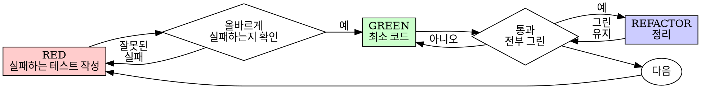

# 테스트 주도 개발 (TDD)

## 개요

테스트를 먼저 쓴다. 실패를 본다. 통과하는 최소 코드를 쓴다.

**핵심 원칙:** 테스트가 실패하는 것을 보지 않았으면, 그것이 올바른 것을 테스트하는지 모른다.

**규칙의 문자를 어기는 것은 정신을 어기는 것이다.**

## 사용 시점

**항상:**
- 새 기능
- 버그 수정
- 리팩터링
- 동작 변경

**예외 (상대방에게 묻는다):**
- 일회용 프로토타입
- 생성된 코드
- 설정 파일

"이번 한 번만 TDD 건너뛰자"는 생각이 들면 멈춰라. 합리화다.

## 철칙

```
실패하는 테스트 없이 프로덕션 코드 금지
```

테스트 전에 코드를 썼으면? 지운다. 처음부터 다시.

**예외 없음:**
- "레퍼런스"로 남기지 않는다
- 테스트 쓰면서 "적응"시키지 않는다
- 보지 않는다
- 지운다는 것은 지운다는 것이다

테스트에서 새로 구현한다. 끝.

## Red-Green-Refactor



### RED - 실패하는 테스트 작성

해야 할 일을 보여주는 최소 테스트 하나를 쓴다.

<Good>
```typescript
test('retries failed operations 3 times', async () => {
  let attempts = 0;
  const operation = () => {
    attempts++;
    if (attempts < 3) throw new Error('fail');
    return 'success';
  };

  const result = await retryOperation(operation);

  expect(result).toBe('success');
  expect(attempts).toBe(3);
});
```
명확한 이름, 실제 동작 테스트, 한 가지
</Good>

<Bad>
```typescript
test('retry works', async () => {
  const mock = jest.fn()
    .mockRejectedValueOnce(new Error())
    .mockRejectedValueOnce(new Error())
    .mockResolvedValueOnce('success');
  await retryOperation(mock);
  expect(mock).toHaveBeenCalledTimes(3);
});
```
모호한 이름, 목이 아닌 코드를 테스트하지 않음
</Bad>

**요구사항:**
- 한 가지 동작
- 명확한 이름
- 실제 코드 (불가피하지 않으면 목 금지)

### Verify RED - 실패를 본다

**필수. 절대 건너뛰지 않는다.**

```bash
npm test path/to/test.test.ts
```

확인:
- 테스트가 실패한다 (에러가 아니다)
- 실패 메시지가 예상대로다
- 기능이 없어서 실패한다 (오타가 아니다)

**테스트가 통과하면?** 기존 동작을 테스트 중이다. 테스트를 고친다.

**테스트가 에러나면?** 에러를 고치고 올바르게 실패할 때까지 다시 실행한다.

### GREEN - 최소 코드

테스트를 통과하는 가장 단순한 코드를 쓴다.

<Good>
```typescript
async function retryOperation<T>(fn: () => Promise<T>): Promise<T> {
  for (let i = 0; i < 3; i++) {
    try {
      return await fn();
    } catch (e) {
      if (i === 2) throw e;
    }
  }
  throw new Error('unreachable');
}
```
통과에 딱 맞게
</Good>

<Bad>
```typescript
async function retryOperation<T>(
  fn: () => Promise<T>,
  options?: {
    maxRetries?: number;
    backoff?: 'linear' | 'exponential';
    onRetry?: (attempt: number) => void;
  }
): Promise<T> {
  // YAGNI
}
```
과잉 설계
</Bad>

기능을 추가하거나, 다른 코드를 리팩터하거나, 테스트 이상으로 "개선"하지 않는다.

### Verify GREEN - 통과를 본다

**필수.**

```bash
npm test path/to/test.test.ts
```

확인:
- 테스트 통과
- 다른 테스트도 여전히 통과
- 출력 깨끗 (에러·경고 없음)

**"다른 테스트"는 프로젝트 스위트 전체다, 내 파일만이 아니다.** 쓴 테스트의 그린 실행은 그린 스위트가 아니다. 끝났다고 하기 전에 프로젝트 테스트 명령(그 레포가 쓰는 `pytest`·`npm test`·`cargo test` — 무엇이든)을 돌린다. 그 실행이 보여준 실패는 — 내가 만든 게 아니어도 — 보고서에 이름으로 들어간다. 지나가는 빨간 테스트를 보고 말하지 않은 것은 누락으로 보고서를 위조한 것이다.

### REFACTOR - 정리

그린 뒤에만:
- 중복 제거
- 이름 개선
- 헬퍼 추출

테스트를 그린으로 유지한다. 동작을 추가하지 않는다.

### 반복

다음 기능의 다음 실패 테스트.

## 좋은 테스트

테스트를 쓰거나 바꿀 때는 [writing-good-tests.md](writing-good-tests.md)를 읽는다:
- 테스트를 쓰기 전에, 그 테스트를 실패하게 만들 프로덕션 변경을 이름 짓는다
- 실제 동작을 assertion한다, 목 동작이 아니다
- 테스트 전용 코드는 테스트 유틸리티에, 프로덕션 클래스에 두지 않는다
- 의존성을 목하기 전에 그 부작용을 이해한다

## 흔한 합리화

| 변명 | 현실 |
|------|------|
| "테스트하기엔 너무 단순해" | 단순한 코드도 깨진다. 테스트는 30초다. |
| "나중에 테스트할게" | 나중에 쓴 테스트는 즉시 통과한다 — 아무것도 증명하지 않는다. 잘못된 것을 테스트하거나, 동작이 아닌 구현을 테스트하거나, 잊은 엣지 케이스를 놓칠 수 있다. 실패를 보지 않았으니 버그를 잡을 수 있다는 걸 증명한 적 없다. |
| "테스트 나중이 같은 목표를 달성해 (형식이 아닌 정신)" | 나중 테스트는 "이게 뭐 하는가"에 답한다. 먼저 테스트는 "이게 뭐 해야 하는가"에 답한다. 나중에 쓴 테스트는 이미 쓴 코드에 편향된다 — 기억한 케이스를 검증하지, 발견했어야 할 케이스를 검증하지 않는다. |
| "이미 수동으로 테스트했다" | 수동 테스트는 즉흥적이다: 무엇을 커버했는지 기록 없고, 코드가 바뀌면 다시 돌릴 방법 없고, 압박 아래 케이스를 잊기 쉽다. "해봤는데 됐어" ≠ 포괄적. 자동 테스트는 매번 같은 방식으로 돈다. |
| "X시간을 날리는 건 낭비야" | 매몰 비용 오류 — 그 시간은 어느 쪽이든 이미 썼다. 진짜 선택: TDD로 다시 쓰기(높은 확신) vs 붙잡고 나중에 테스트 붙이기(낮은 확신, 버그 유력). 믿을 수 없는 코드를 붙잡는 게 낭비다. |
| "레퍼런스로 남기고 테스트 먼저 쓸게" | 적응시킬 것이다. 그게 나중 테스트다. 지운다는 것은 지운다는 것이다. |
| "먼저 탐색이 필요해" | 좋다. 탐색은 버리고 TDD로 시작한다. |
| "TDD가 느리게 해" | TDD가 실용적 경로다: 커밋 전 버그를 잡고, 회귀를 막고, 두려움 없이 리팩터한다. "실용적" 지름길은 프로덕션 디버깅 — 더 느리다, 빠르지 않다. |
| "기존 코드에 테스트가 없어" | 개선하는 중이다. 기존 코드에 테스트를 추가한다. |

## 경고 신호 — 멈추고 처음부터

- 테스트 전 코드
- 구현 뒤 테스트
- 즉시 통과하는 테스트
- 왜 테스트가 실패했는지 설명 불가
- "나중에" 추가되는 테스트
- "이번 한 번만" 합리화
- "이미 수동으로 테스트했다"
- "레퍼런스로 남기자" 또는 "기존 코드 적응"

**전부: 코드 지우고 TDD로 처음부터.**

## 예시: 버그 수정

**버그:** 빈 이메일이 통과됨

**RED**
```typescript
test('rejects empty email', async () => {
  const result = await submitForm({ email: '' });
  expect(result.error).toBe('Email required');
});
```

**Verify RED**
```bash
$ npm test
FAIL: expected 'Email required', got undefined
```

**GREEN**
```typescript
function submitForm(data: FormData) {
  if (!data.email?.trim()) {
    return { error: 'Email required' };
  }
  // ...
}
```

**Verify GREEN**
```bash
$ npm test
PASS
```

## 검증 체크리스트

완료 표시 전:

- [ ] 모든 새 함수/메서드에 테스트가 있다
- [ ] 각 테스트가 구현 전 실패하는 것을 봤다
- [ ] 각 테스트가 예상된 이유(기능 없음, 오타 아님)로 실패했다
- [ ] 각 테스트를 통과하는 최소 코드를 썼다
- [ ] 모든 테스트가 통과한다
- [ ] 출력이 깨끗하다 (에러·경고 없음)
- [ ] 테스트가 실제 코드를 쓴다 (목은 불가피할 때만)
- [ ] 엣지 케이스와 에러를 커버한다

전부 체크 불가? TDD를 건너뛴 것이다. 처음부터.
